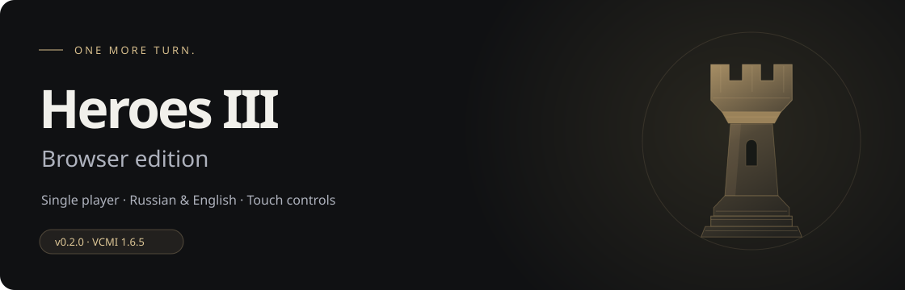
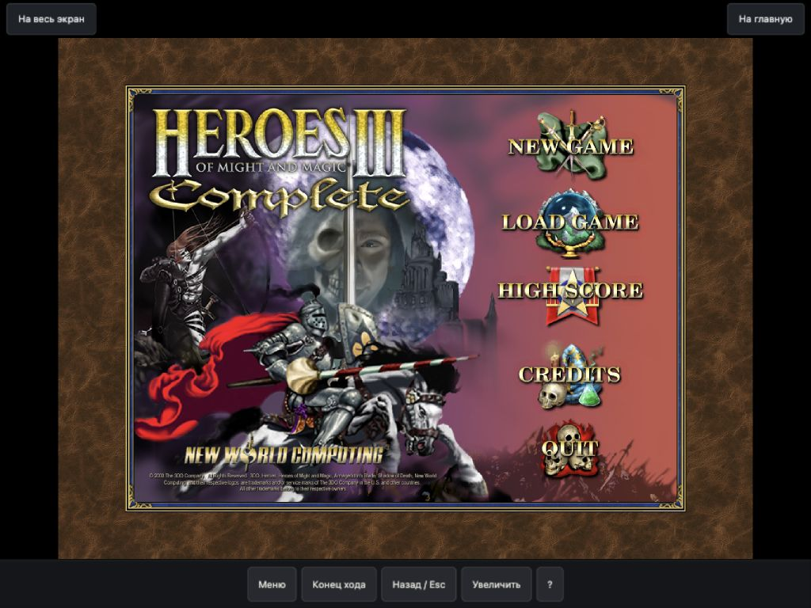

<p align="center"></p>
<p align="center"><a href="https://heroes-iii-browser.pages.dev/"></a></p>
<p align="center"><strong>One more turn. Right in your browser.</strong><br>v0.2.0 · VCMI 1.6.5 · <a href="README.ru.md">Русский</a></p>

A browser launcher for **Heroes of Might and Magic III Complete**, powered by the [VCMI WebAssembly port](https://github.com/caiiiycuk/vcmi-wasm/tree/vcmi-wasm-1.6.5). Keep the original game menus and turn-based experience, with a modern way to launch, manage files and play on a touchscreen.

**[Play online](https://heroes-iii-browser.pages.dev/)** · **[Report a problem](https://github.com/JevgeniSoonberg/heroes3-browser/issues/new)** · **[Build your own](docs/BUILD.md)** · **[Release notes](docs/releases/v0.2.0.md)**

## What’s included

- **Russian and English.** Choose before launching; both versions share saves in the same browser.
- **Mouse, keyboard and touch.** Automatic touch controls, hold to inspect, pinch to zoom, and on-screen commands. iPad uses an 800 × 600 rendering profile.
- **Portable progress.** Export/import saves as ZIP. Back up and transfer your custom map collection separately.
- **Your maps.** Add `.h3m` files or ZIP collections; find them in the original scenario menu. RoE, Armageddon’s Blade and Shadow of Death formats are supported.
- **Clear loading and recovery.** Five launch stages, cached resources, SHA-256 checks and bounded retries. Damaged resources are repaired individually.
- **Practical tools.** Cache management, browser checks, bilingual Help and a prefilled GitHub issue draft.

The first launch downloads the selected language’s game files. Later launches reuse cached resources and verify them. Saves and maps stay in this browser; there is no account or cloud sync. Export important progress before clearing site data.

<details>
<summary><strong>Touch-control preview</strong></summary>



Development capture of the original game menu. The launcher and translated control labels have since evolved.
</details>

## Source and publication

**Just want to play?** Open the [website](https://heroes-iii-browser.pages.dev/). Your friend does not need to clone this repository or run a terminal.

**Want to build the site for publication?** You need Python 3.10+, an internet connection for the pinned engine download, and your own compatible Heroes III Complete / Shadow of Death data. The original game files are **not included in this repository or source release**. [VCMI also requires original game data](https://vcmi.eu/). Steam HD Edition alone is not the supported dataset for this build.

```sh
python3 scripts/fetch_engine.py
python3 scripts/build.py --english "/path/to/Heroes III Complete" --out dist
```

Upload the generated `dist/` directory to your static HTTPS host. The included `_headers` configures Cloudflare Pages. For both languages:

```sh
python3 scripts/build.py --russian "/path/to/Russian game" --english "/path/to/English game" --out dist-bilingual
```

The builder accepts either language or both. It writes a static site and splits large resources into host-compatible parts. See [BUILD.md](docs/BUILD.md) for directory layout, HTTPS hosting, the iPad memory helper and the pinned upstream engine sources.

## Compatibility and limits

| Supported here | Not part of this release |
| --- | --- |
| Single-player scenarios, RU/EN, local saves, custom maps | Multiplayer, HotA, WoG and HD Mod |
| Desktop browsers and touch devices with the required browser APIs | A promise that every device has enough RAM |
| Map ZIP import/export: 64 maps / 64 MiB, up to 8 MiB per map | Campaigns have not been fully tested |
| Save transfers: up to 32 MiB of data per operation | Cloud save sync or a fully offline launcher |

Browser storage, performance and memory limits vary by device. If an iPad reports `out of memory`, fully close the game tab and reopen the site. Do not erase site data to address RAM issues; that would also remove local saves and maps. The hosted site uses a short helper-page transition when needed to release old Safari game memory.

## Development

Runtime browser code lives in `src/`. The upstream engine is downloaded into ignored paths; development does not require checking in engine binaries or proprietary assets.

```sh
npm ci --ignore-scripts
npm test
```

Node 22 and Python 3.10+ are used for the checks. Tests use synthetic fixtures, fake IndexedDB and browser API substitutes; real-device verification is documented in [QA.md](docs/QA.md). See [CONTRIBUTING.md](CONTRIBUTING.md).

## Credits and licensing

Project code is provided under **GPL-2.0-or-later**; see [LICENSE](LICENSE). VCMI and its WebAssembly port, fflate and noble-hashes retain their own licenses and credits. See [THIRD_PARTY_NOTICES.md](THIRD_PARTY_NOTICES.md) for versions, source references and bundled notices.

Heroes of Might and Magic III and the game artwork belong to their respective rights holders. Original game files and screenshots of that artwork are not relicensed by this project. This is an unofficial fan project, with no affiliation to Ubisoft or the original developers.
