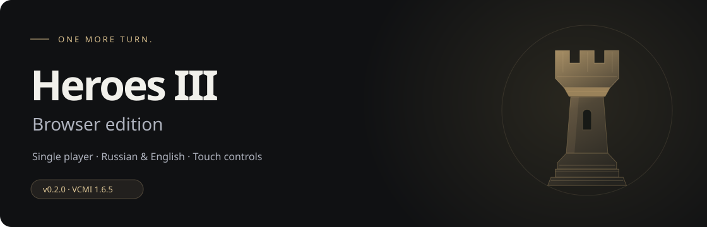
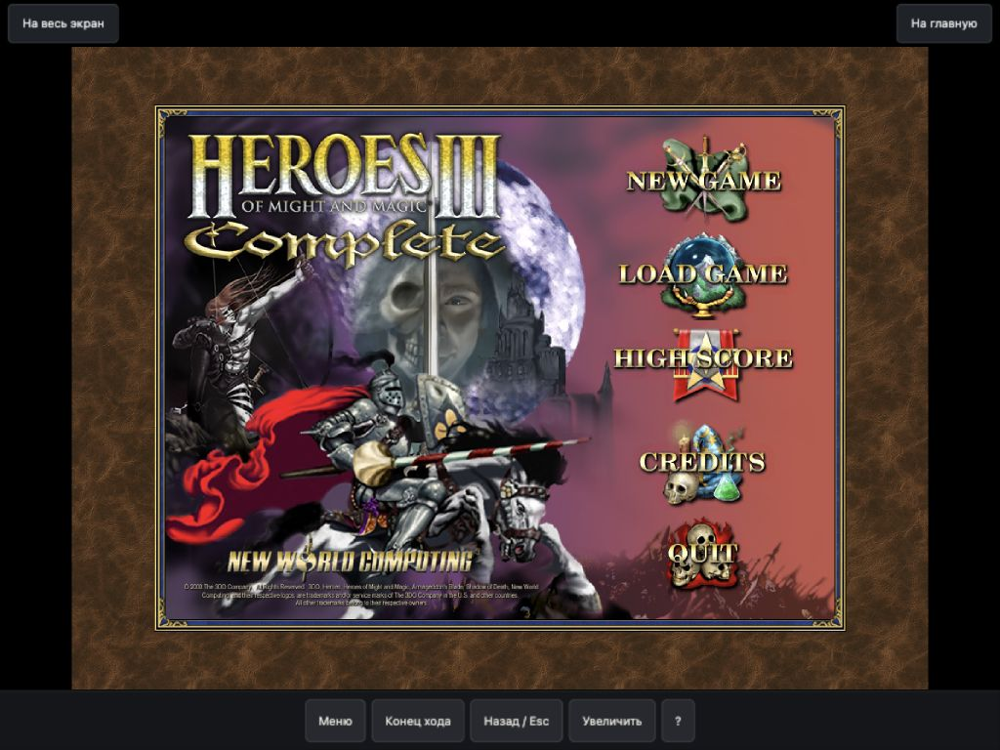

<p align="center"></p>
<p align="center"><a href="https://heroes-iii-browser.pages.dev/"></a></p>
<p align="center"><strong>Ещё один ход. Прямо в браузере.</strong><br>v0.2.1 · VCMI 1.6.5 · <a href="README.md">English</a></p>

Браузерная оболочка для **Heroes of Might and Magic III Complete** на основе [VCMI WebAssembly](https://github.com/caiiiycuk/vcmi-wasm/tree/vcmi-wasm-1.6.5). Внутри сохраняются привычные меню и игровой процесс, а снаружи — удобный запуск и управление личными данными.

**[Играть](https://heroes-iii-browser.pages.dev/)** · **[Сообщить о проблеме](https://github.com/JevgeniSoonberg/heroes3-browser/issues/new)** · **[Собрать свою копию](docs/BUILD.md)** · **[Выпуск 0.2.0](docs/releases/v0.2.0.md)**

## Возможности

- Русский и английский с общими сохранениями. При первом посещении выбирается язык браузера: русский → русский, остальные → английский. Ручной выбор запоминается.
- Мышь и клавиатура или автоматическое сенсорное управление. На iPad используется режим 800 × 600.
- Экспорт и импорт сейвов в ZIP; отдельный перенос коллекции своих карт.
- Импорт `.h3m` и ZIP с картами RoE, Armageddon’s Blade и Shadow of Death. Выбор карты — в оригинальном меню игры.
- Пять этапов запуска, кэш ресурсов, проверка SHA-256 и восстановление загрузки.
- Управление скачанными файлами, проверка браузера, помощь и подготовленный текст обращения в GitHub.

Первый запуск скачивает ресурсы выбранного языка. Повторный использует кэш и проверяет целостность файлов. Сейвы и карты хранятся в этом браузере: аккаунта и облачной синхронизации нет. Делай копии важных партий перед очисткой данных сайта.

<details><summary><strong>Пример сенсорного управления</strong></summary>



Снимок игрового меню из процесса разработки. Главная страница и переведённые подписи управления с тех пор изменились.
</details>

## Как играть

Для обычной игры достаточно **[открыть сайт](https://heroes-iii-browser.pages.dev/)**. Клонировать репозиторий и запускать терминал игроку не нужно.

Для сборки сайта под публикацию понадобятся Python 3.10+, интернет для загрузки закреплённого движка и свои файлы Heroes III Complete / Shadow of Death. **Оригинальные игровые файлы не входят в репозиторий или архив исходников.** Одна Steam HD Edition не является подходящим набором данных для этой сборки.

```sh
python3 scripts/fetch_engine.py
python3 scripts/build.py --english "/путь/к/English game" --out dist
```

Папка `dist/` — готовые статические файлы для HTTPS-хостинга; `_headers` содержит настройки Cloudflare Pages. Можно собрать только русский язык:

```sh
python3 scripts/build.py --russian "/путь/к/Russian game" --out dist-ru
```

Или передать обе папки через `--russian` и `--english`. Подробности структуры файлов, HTTPS-размещения и служебного перехода для iPad — в [инструкции сборки](docs/BUILD.md).

## Ограничения

- Заявлены одиночные сценарии. Мультиплеер, HotA, WoG и HD Mod не включены; кампании не проверены полностью.
- Свои карты: до 64 карт / 64 МиБ, до 8 МиБ на карту. Перенос сейвов: до 32 МиБ данных за операцию.
- Нет облачных сохранений и полностью автономного офлайн-запуска оболочки.
- Производительность и доступная память зависят от устройства. При `out of memory` полностью закрой вкладку с игрой и открой сайт заново. Очистка данных сайта не решает нехватку RAM, но удаляет локальные сейвы и карты.

## Разработка и лицензии

```sh
npm ci --ignore-scripts
npm test
```

Для проверок используются Node 22 и Python 3.10+. Автотесты используют синтетические данные; ручные проверки описаны в [QA.md](docs/QA.md). Дополнения — в [CONTRIBUTING.md](CONTRIBUTING.md).

Код проекта — **GPL-2.0-or-later**, см. [LICENSE](LICENSE). Лицензии и источники VCMI, fflate и noble-hashes перечислены в [THIRD_PARTY_NOTICES.md](THIRD_PARTY_NOTICES.md). Оригинальная игра и её графика принадлежат соответствующим правообладателям и не перелицензируются этим проектом. Это неофициальный фанатский проект.
